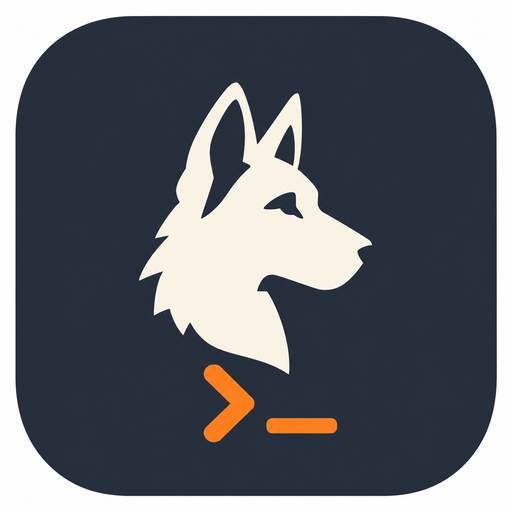
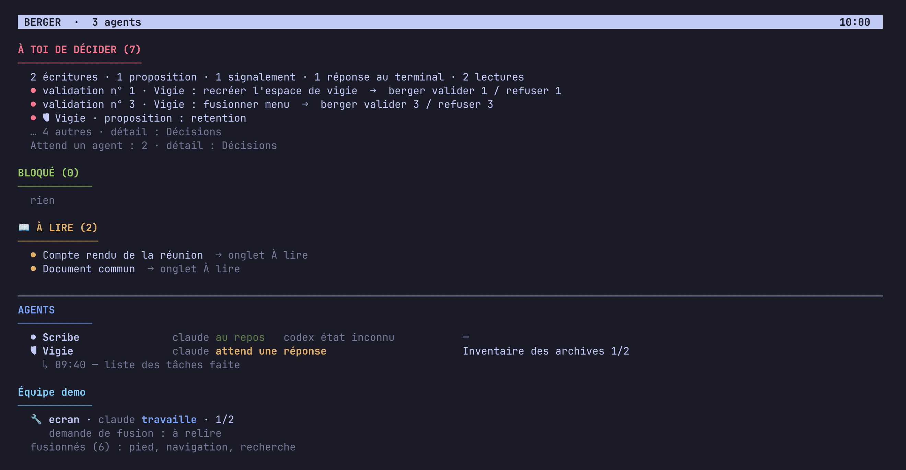
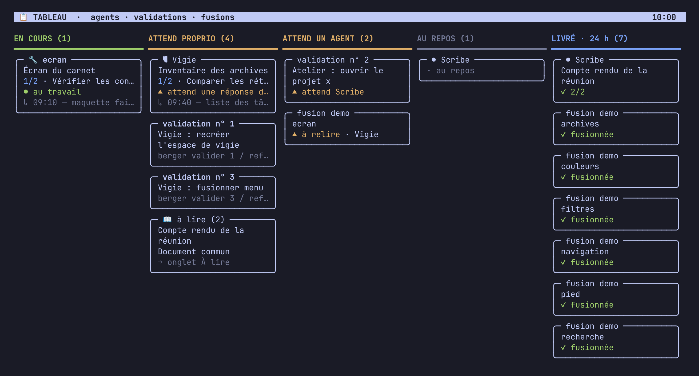
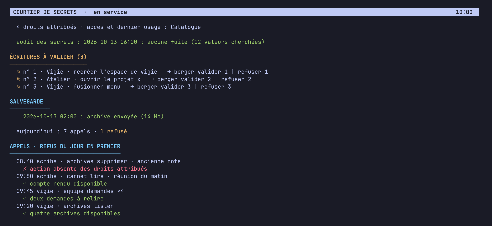

# Berger



**Your agents. Your methods. Your choice of engine.**


[Français](README.fr.md) · [Reference manual, in French](docs/manuel.md)

Berger gives agents a working identity, memory, checklists and scheduled tasks
through plain files that you own.
It runs the official **Codex** and **Claude Code** CLIs with their subscriptions.
Herdr provides the workspaces, panes and status views.

Keep your methods when you change engines.
The supported engines are Codex and Claude Code; an arbitrary provider adapter
is not part of this project.
Berger does not call a model provider API directly.

## Quick start

Use a new installation in `~/berger`; do not overwrite existing data or links.
There is no bundled dependency installer. The [short English installation
guide](docs/install.md) explains the manual steps and troubleshooting.

### Prerequisites

- Linux, Git, Bash, Python **3.11+** (`tomllib`), [Herdr](https://herdr.dev) **0.9+**.
- Codex **0.160+** and/or Claude Code installed and authenticated with your subscription.
- Working **bubblewrap**, **GnuPG** and **systemd user services**.
- Herdr available at `~/.local/bin/herdr`, as expected by the supplied units.

Check the sandbox with `bwrap --ro-bind / / --dev /dev --unshare-net true`.
On Ubuntu 24.04+, an administrator may need the bubblewrap AppArmor profile in
[the reference](docs/manuel.md#installation-résumé). A strict agent refuses to
start without its sandbox.

### Prepare the checkout

Clone the repository, then work from its root:

```bash
git clone https://github.com/lugio/berger.git ~/berger
cd ~/berger
cp config.exemple.toml config.toml
cp commun/modeles/USER.md commun/USER.md
mkdir -p ~/.local/bin ~/.config/systemd/user
ln -s "$PWD/bin/berger" ~/.local/bin/berger
ln -s "$PWD/courtier/berger-outil" ~/.local/bin/berger-outil
export PATH="$HOME/.local/bin:$PATH"
```

Before continuing, **edit `config.toml`**: set `proprietaire` to your name and
review `coffre`, `masques`, `masques_si_presents` and `masque_fichier` for your
machine. The copied example supports a first agent without external tools;
its tool declarations are commented out and it supplies no custom guard.
Keep credential storage protected and local configuration out of Git.
Complete `commun/USER.md` with whom the agents work for.

### Create an agent and start the services

```bash
berger nouveau assistant "Assistant"
```

Expected: `agent créé :` followed by `agents/assistant`'s absolute path.
Edit `agents/assistant/SOUL.md` to define its role, capabilities and limits.
Set `heures = aucune` in `agents/assistant/agent.conf` to run only on request.
The default engine is Codex. For Claude Code, set both `moteur` and `panneaux`
to `claude` and use its authenticated CLI instead of the Codex login below.
Then regenerate the settings; Codex login requires an interactive sign-in:

```bash
berger regenerer
CODEX_HOME="$HOME/berger/.codex" codex login
cp systemd/* ~/.config/systemd/user/
systemctl --user daemon-reload
systemctl --user enable --now berger.timer berger-courtier.service berger-herdr.service
berger espace assistant
berger espace ensemble
berger etat
```

Expected: an Assistant workspace with its conversation and a Berger workspace
showing the agent state. Ask it to introduce its role; it should reflect `SOUL.md`.
Review engine hook approval prompts. The first launch of an engine version runs
its admission contract (up to 20 minutes); rejection can trigger fallback to
another admitted engine, or refusal if none is admitted. See
[which tests to run](docs/manuel.md#tests--quand-lancer-quoi) and
[security](docs/manuel.md#sécurité-identique-pour-chaque-agent-et-chaque-moteur).
Login, local configuration, approval and admission are required manual steps.

## Features

| Capability | What it does | Guide, in French |
| --- | --- | --- |
| Portable agent methods | Identity, instructions and working files stay on disk | [Principles](docs/manuel.md#principes) |
| Engine choice | Run Codex or Claude Code through their official CLIs | [Commands](docs/manuel.md#commandes) |
| Memory and work tracking | Journals, tasks, checklists and proposed long-term memory | [Herdr views](docs/manuel.md#dans-herdr) |
| Agent workspace layout | Per-agent `espace.toml`, validated proposals and automatic application without restarting the conversation | [Workspace layout](docs/manuel.md#dans-herdr) |
| Scheduled work | Heartbeats and tasks driven by the user timer | [Operations](docs/manuel.md#exploitation) |
| Brokered tools | Declared verbs and configured human approvals | [Broker](docs/manuel.md#courtier) |
| Missions and teams | Delegate scoped work and review changes before merging | [Development teams](docs/manuel.md#équipe-de-développement-gros-projets) |
| Shared deliverables | Agent and project libraries, with access boundaries | [Library](docs/manuel.md#bibliothèque--dossiers-de-travail-des-agents) |
| Optional web views | Read-only views of the same operational data | [Web interface](docs/manuel.md#interface-web-lecture-seule) |
| Configured backups | Encrypted archives for installation data | [Backups](docs/manuel.md#sauvegarde-des-données) |

## Herdr views

The interface is in French; the data below is fictional. Reproduce it with
[the demo views guide](docs/demo-vues.md).


*Home: what is waiting for a decision.*


*Column board: agents, approvals and merges.*


*Secrets broker: permissions, writes awaiting approval and calls.*

## Safety and limits

The host, the broker and configured tool adapters are trusted components.
Strict agents use generated permissions and sandbox settings for their engine.
An agent configured with `mur = ouvert` must not be treated as isolated.

Engine versions must pass their admission contract before strict use.
A passing model-free suite is **not** an engine admission result.
Tests establish measured behavior; they are not a universal security guarantee.
Hooks, temporary directories, MCP relays and host restrictions have documented limits.

Credentials belong in the configured store outside the agent's readable files.
Broker filtering and declared approvals help control access; review the actual
permissions and tool implementation for your installation.
Agents can write inside their allowed working areas.
Long-term memory changes are proposed for review rather than silently consolidated.

See [SECURITY.md](SECURITY.md) for private vulnerability reporting.
Do not put real credentials or personal agent data in issues or pull requests.

## How it works

Herdr hosts the workspaces; Berger prepares the agent and its engine profile.
Tool requests go through the file mailbox to the trusted broker.
The broker checks the declared verb, obtains approval when required and invokes
the configured adapter. Results return through the broker to the requesting agent.
A view, a command or an engine is one dropped file (core API, `bin/noyau/api.py`); a broken module is set aside and named by `berger etat`.

<!-- BEGIN BERGER DIAGRAM -->
```text
Agent files ----> Berger ----> official CLI
                    ^              |
                    |              v
                  Herdr         agent work
                                   |
                         file mailbox (berger-outil)
                                   |
                              trusted broker
                         (approval when required)
                                   |
                           configured tools
```
<!-- END BERGER DIAGRAM -->

This diagram is generated by `python3 docs/scripts/schema.py --write`. Use `--check` to detect drift without changing files.
It shows the core tool-request path; optional web and MCP flows are in the manual.

## Documentation

| Document | Purpose |
| --- | --- |
| [French reference manual](docs/manuel.md) | Full installation, commands and operations |
| [Configuration example](config.exemple.toml) | Installation settings and tool declarations |
| [Master setup](docs/manuel.md#installer-le-master-pas-à-pas) | Configure the coordinating agent |
| [Contributing](CONTRIBUTING.md) | Spec, tests, gates and independent review |
| [Security policy](SECURITY.md) | Private reporting and scope |
| [Code of conduct](CODE_OF_CONDUCT.md) | Community expectations and moderation |
| [Changelog](CHANGELOG.md) | Documented version history |
| [Roadmap](docs/ROADMAP.md) | Planned work and the state of the modular refactoring |

The full manual remains in French; both entry points link to the same reference.

## Removal

Back up agent data, configuration, libraries and credentials before removing them.
Use encrypted storage for backups containing secrets.
Finish or stop active agent work before stopping the services.
Inspect the units you enabled with `systemctl --user list-unit-files 'berger*'`.
Stop the core services and scheduler installed by the quick start:

```bash
systemctl --user disable --now berger.timer berger-courtier.service berger-herdr.service
```

Also disable optional `berger-tests.timer` and `berger-interface.service` if enabled.
Remove the local `berger.reprise` plugin link using your Herdr version's plugin help
(`herdr plugin --help`) so a later Herdr start will not resume Berger agents.
Remove only the user unit files and command symlinks you added for Berger,
then reload user units with `systemctl --user daemon-reload`.
Delete the checkout and private data only after checking your backups.
Removal is manual; Berger does not provide a universal uninstall command.

## Contributing

Start with [CONTRIBUTING.md](CONTRIBUTING.md) and a small spec for substantial changes.
Bug fixes need a reproduced failure, a root cause and a regression test.
Run `verify`, `tests` and `pret`; the contribution guide gives the exact commands.
The prepared CI workflow uses a fresh local clone with an isolated home directory.
It does not replace real-engine admission tests.

## License

Berger is distributed under the [MIT license](LICENSE).
The current documented version is [0.2.0](CHANGELOG.md); earlier versions are listed there too.
Engine subscriptions, Herdr and external tools have their own terms and licenses.
